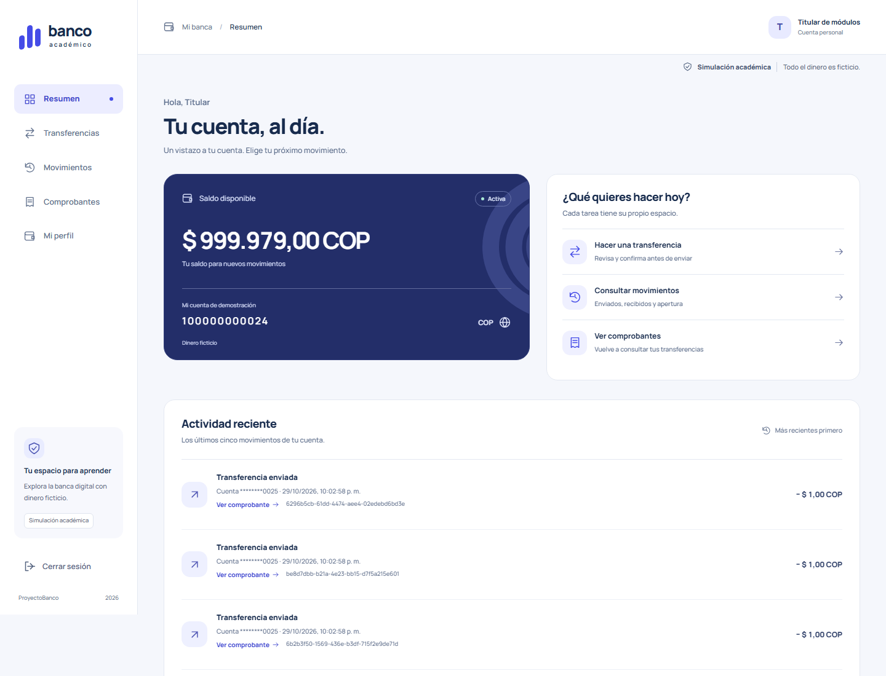
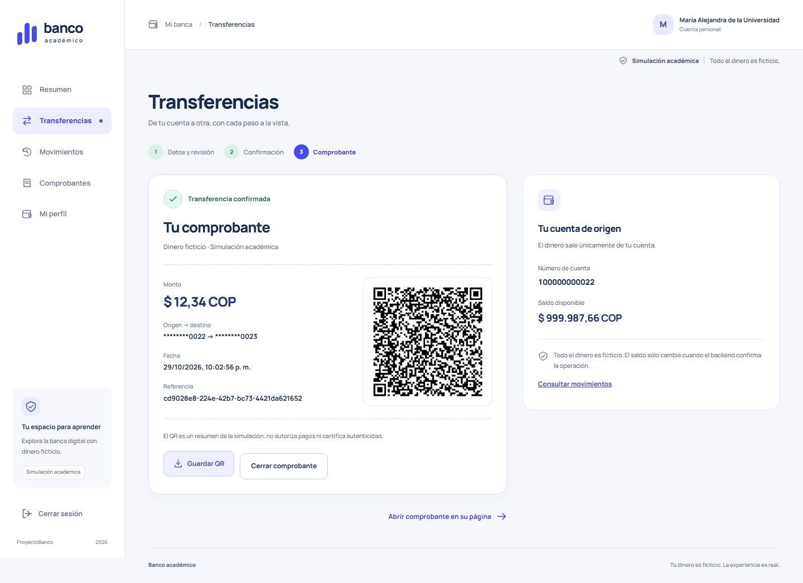
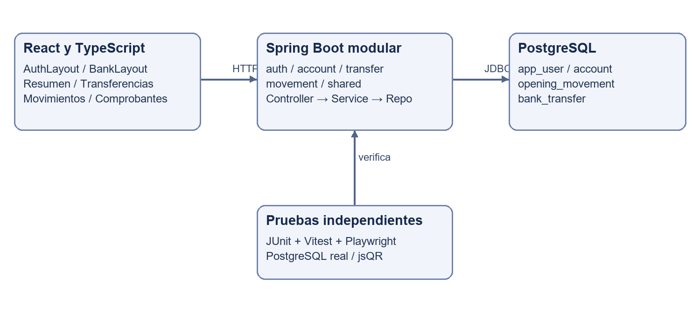

# ProyectoBanco

Simulación académica full stack para transferir dinero entre cuentas en pesos colombianos, consultar movimientos y recuperar comprobantes QR. **Todo el dinero es ficticio.** Ejercicio del Tecnológico de Antioquia, entrega 30 de octubre de 2026.

## Entrega académica

- Informe: [PDF](docs/Informe_ProyectoBanco.pdf), [Word](docs/Informe_ProyectoBanco.docx), [Markdown](docs/informe.md).
- Prompts: [PDF](docs/Prompts_Utilizados.pdf), [Word](docs/Prompts_Utilizados.docx), [Markdown](docs/prompts.md).
- [Guía de sustentación](docs/guia-sustentacion.md) con preguntas, demostración y SQL de lectura.
- [Matriz y verificación final](docs/verificacion-entrega.md).
- [Enunciado original](SpringBoot%20AI.pdf), ejercicio en página 11.

La nueva documentación está preparada localmente en `developer`. No se hizo push ni merge; `main` permanece intacta. Los enlaces anteriores estarán disponibles en GitHub cuando se publique esta actualización autorizadamente.

## Funcionalidades

Registro con cuenta automática y apertura única de 1000000.00 COP, acceso/logout, sesión con 30 minutos de inactividad, saldo y cuenta, transferencias con revisión, idempotencia y recuperación de respuesta incierta. Histórico privado con apertura/enviados/recibidos, comprobantes autorizados y QR descargable desde el resultado confirmado.

Módulos independientes con React Router: `/#/login`, `/#/registro`, `/#/resumen`, `/#/transferencias`, `/#/movimientos`, `/#/comprobantes`, `/#/comprobantes/:reference` y `/#/perfil`. HashRouter permite recarga de enlaces en el JAR sin cambiar Spring. Perfil sólo lectura. Búsqueda y filtros operan sobre la página cargada; no se simula búsqueda global.





## Tecnologías y arquitectura

Java 25, Spring Boot 4.1.2, Spring Security/Data JPA/JDBC y PostgreSQL 18.6 observado. React 19.3.1, TypeScript 6.0.3, React Router 8.5.0, Vite 8.3.5 y Node 24. Versiones frontend fijadas en package-lock; Maven Wrapper incluido. Javadoc documenta API Java; Vitest/JUnit/Playwright verifican el comportamiento.

Monolito modular con una aplicación Spring y una base por entorno. `auth`, `account`, `transfer` y `movement` agrupan controller/DTO/service y persistencia; `shared` contiene seguridad/configuración/errores. React se organiza por funcionalidades y mantiene el coordinador bancario por encima de las rutas protegidas.



```text
backend/src/main/java/co/edu/tdea/bank/  módulos de negocio
backend/src/main/resources/db/         esquema SQL
backend/src/test/                      integración e inactividad
frontend/src/app/                     router layouts contexto
frontend/src/features/                módulos de interfaz
frontend/src/shared/                  API tipos componentes utilidades
frontend/tests/                       HTTP UI QR y persistencia
scripts/                              arranque y comprobaciones
docs/                                 entregables y evidencias
specs/                                decisiones y verificaciones históricas
```

## Instalación y ejecución en Windows

Requisitos del entorno reproducido: JDK 25, Node 24/npm, PowerShell y PostgreSQL 18 con herramientas en `C:/Program Files/PostgreSQL/18/bin`. Primera preparación requiere acceso a npm/Maven Central. No se requiere Docker.

```powershell
git clone https://github.com/Sbedoyar/ProyectoBanco.git
cd ProyectoBanco
git switch developer
./scripts/local-db.ps1
npm.cmd --prefix frontend ci
npm.cmd --prefix frontend run build
./backend/mvnw.cmd -f backend/pom.xml -B -ntp -DskipTests package
./scripts/start-backend.ps1 -Mode demo
```

Abrir [aplicación local](http://127.0.0.1:8080). Esperar `Started BankApplication` en `.local/backend-demo.log`. React compilado se incluye en el JAR; construir frontend antes de Maven. Registrar cuentas con datos ficticios; los datos persisten entre arranques. El código también incluye fixtures públicos para demo/tests; no usar sus contraseñas como credenciales personales.

`local-db.ps1` crea un clúster dedicado en `.local/pgdata`, puerto 55432, con bases/roles `bank_demo` y `bank_test`. Guarda claves aleatorias sólo en `.local/database.json`, ignorado. No altera el servicio PostgreSQL existente. Para otra ubicación: `./scripts/local-db.ps1 -PostgresBin 'ruta/al/bin'`.

Para desarrollo, mantener backend demo activo y ejecutar `npm.cmd --prefix frontend run dev`; abrir 5173. Vite reenvía `/api` a 8080. Pruebas: backend 8081 y Vite 5187. Para detener demo: `./scripts/stop-backend.ps1 -Mode demo`. No arrancar dos procesos del mismo modo.

Variables: `DB_URL`, `DB_USERNAME`, `DB_PASSWORD`; opcionales `PORT` y `COOKIE_SECURE`. Los scripts las configuran sin imprimir valores. HTTP local escucha sólo en 127.0.0.1; un hosting requiere HTTPS/endurecimiento y autorización separada. Nunca publicar `.local`, `.env`, volcados o llaves privadas.

## Pruebas reproducibles

```powershell
# Instalar navegador sólo la primera vez
Push-Location frontend
npm.cmd exec playwright install chromium
Pop-Location
./scripts/local-db.ps1
./scripts/check-all.ps1 -EvidenceDirectory docs/evidencias/nueva-verificacion
# El runner detiene demo/test para reemplazar el JAR en Windows
./scripts/start-backend.ps1 -Mode demo
```

JUnit y Playwright usan `bank_test` y deben ejecutarse secuencialmente. JUnit limpia únicamente la base de prueba tras comprobar nombre/rol/URL. No usarla para demostraciones. La falla SQL inducida en el caso de rollback es esperada.

Verificación ejecutada 29-10-2026 Bogotá: **14 Java + 21 Vitest + 15 Playwright = 50 aprobadas, 0 fallidas, 0 omitidas**. Nueve checks en código 0: frontera SHA256, unitarias, build React, lint, formato, package Java, integración PostgreSQL, E2E y Javadoc. [Comandos ylogs publicables](docs/evidencias/verificacion-2026-10-29/resultados-publicables.json). No hay insignias ni métricas de cobertura inventadas.

Para ejecutar por separado: `./scripts/test-backend.ps1`, `npm.cmd --prefix frontend run test -- --run`, `npm.cmd --prefix frontend run lint`, `npm.cmd --prefix frontend run format:check`, `npm.cmd --prefix frontend run build`, `./scripts/test-ui.ps1` y `./backend/mvnw.cmd -f backend/pom.xml -B -ntp javadoc:javadoc`. Javadoc queda en `backend/target/reports/apidocs`.

## Histórico y QR

El histórico combina `opening_movement` con `bank_transfer`: una transferencia se presenta como enviada al origen y recibida al destino. Se ordena por fecha/ID, se pagina y muestra contraparte enmascarada. Apertura no tiene recibo.

El QR codifica JSON versión 1 con simulación, referencia, fecha UTC, monto decimal, COP y cuentas enmascaradas. Playwright decodifica el PNG con jsQR y compara los datos. Generar/guardar QR o visitar/recargar el comprobante sólo consulta: no repite el débito. Es un resumen sin firma y no autoriza pagos.

## API e integridad

| Método | Ruta bajo /api | Resultado |
| --- | --- | --- |
| GET | /auth/csrf | Token CSRF |
| POST | /auth/register | Identidad/cuenta/apertura atómicas |
| POST | /auth/login | Autenticación y sesión |
| POST | /auth/logout | Invalida sesión |
| GET | /auth/me | Identidad propia |
| GET | /account | Cuenta propia |
| GET | /movements?page=0&size=20 | Página OPENING/SENT/RECEIVED |
| POST | /transfers | Recibo nuevo 201 o replay 200 |
| GET | /transfers/by-key/{key} | Resultado confirmado del origen |
| GET | /transfers/{reference} | Recibo sólo para participantes |

Transferencia recibe `targetAccountNumber` y `amount` como cadena; el origen sale de la sesión. Mutaciones exigen CSRF y transferencias `Idempotency-Key` UUID. Se usa BigDecimal/NUMERIC(19, 2), locks en orden, replay idéntico y transacción única. Una respuesta perdida no prueba rechazo; conservar clave y contenido.

## Límites y repositorio

Simulación local, sin integración financiera, recuperación de contraseña ni auditoría bancaria. El SQL inicial no reemplaza una estrategia de migraciones futura. QR no firmado, búsqueda sólo de página y validación visual acotada a Chromium Windows. Respaldar antes de modificar esquema; no alterar saldos para preparar evidencias.

Repositorio [Sbedoyar/ProyectoBanco](https://github.com/Sbedoyar/ProyectoBanco). Trabajar en `developer`; no modificar `main`. [Revisión de Git y seguridad](docs/evidencias/git-seguridad.json). La fuente Manrope se distribuye con [licencia OFL](frontend/public/fonts/OFL.txt).
