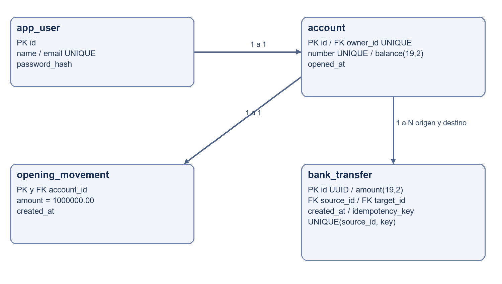
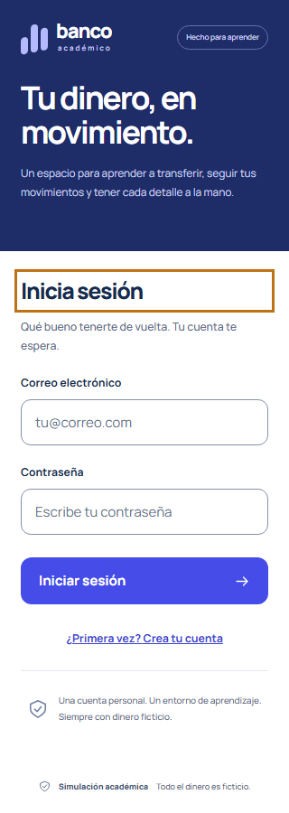
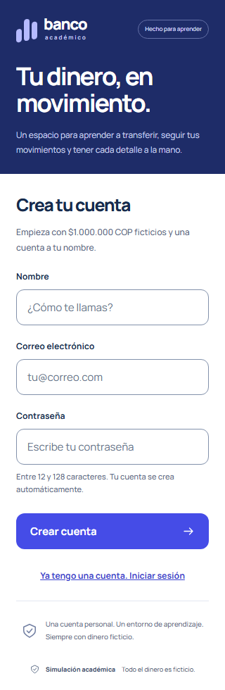
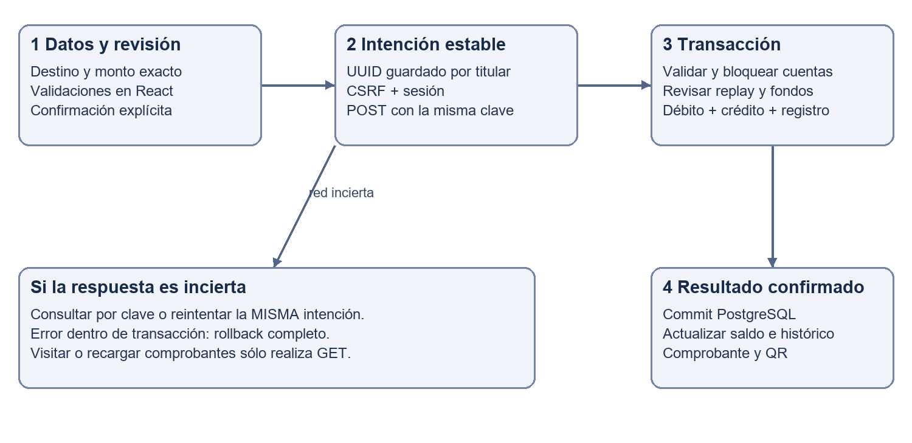
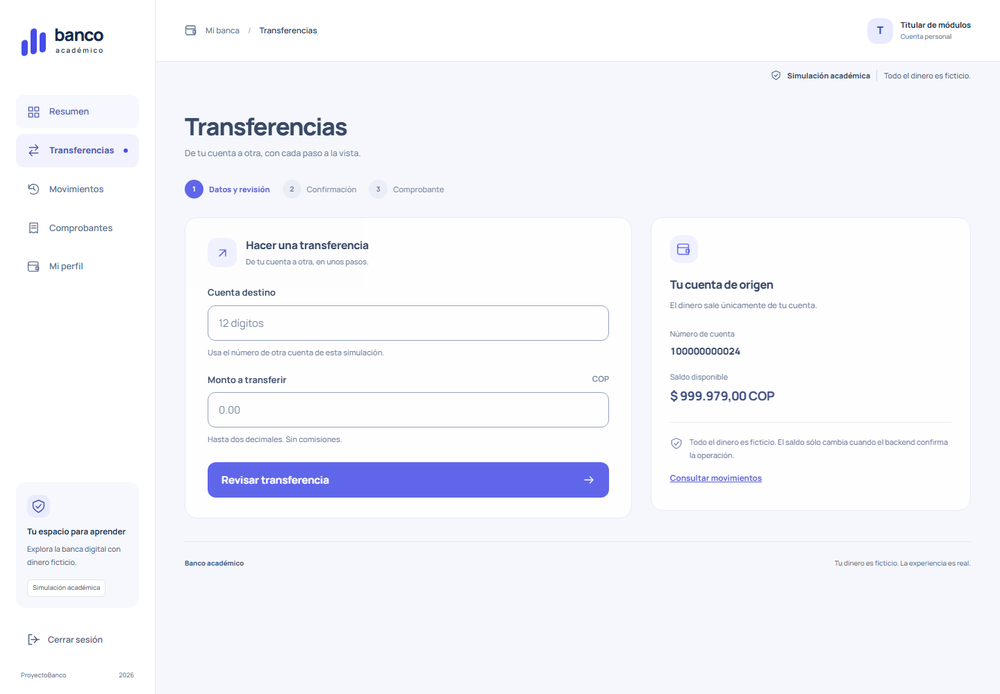
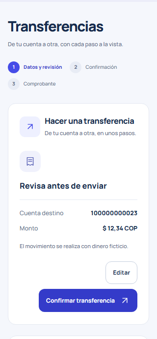
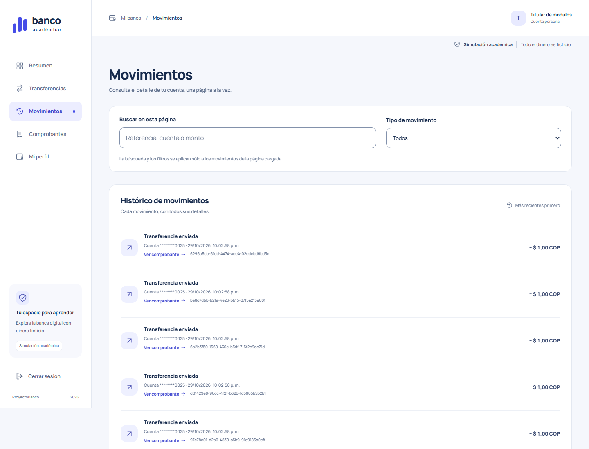
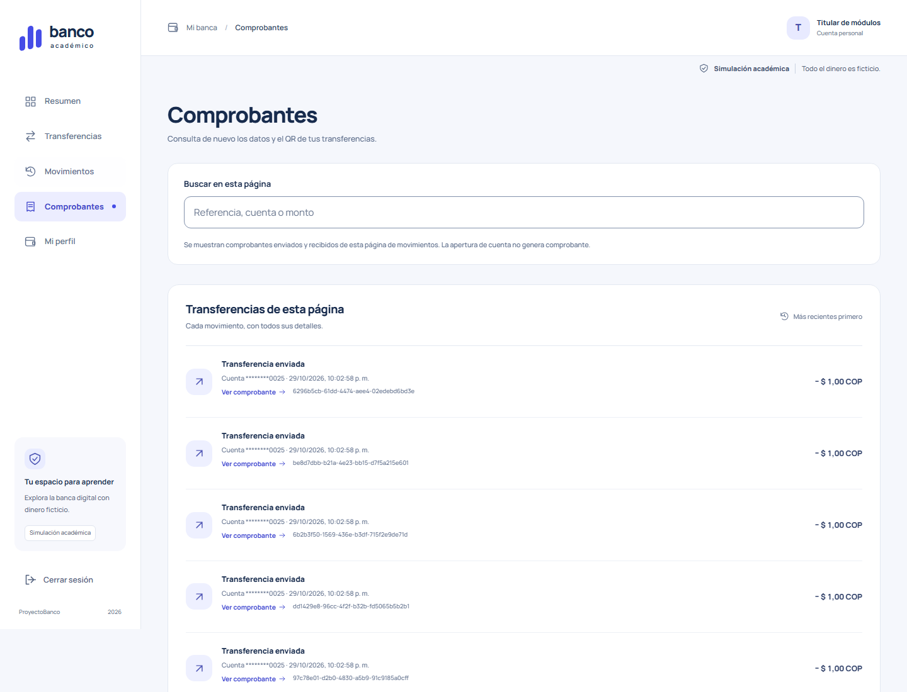
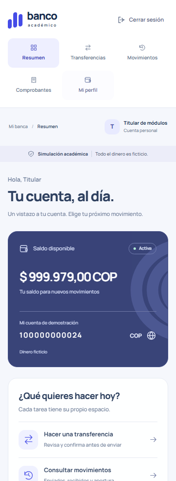
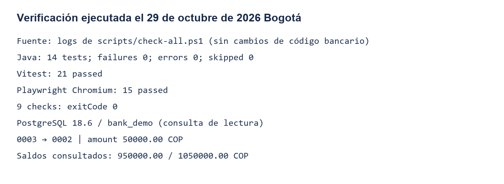

# Informe académico de ProyectoBanco

Tecnológico de Antioquia  
Asignatura Diseño del Sistema  
Integrantes [PENDIENTE DE COMPLETAR]  
Docente [PENDIENTE DE COMPLETAR]  
Grupo [PENDIENTE DE COMPLETAR]  
Entrega 30 de octubre de 2026  
Verificación 29 de octubre de 2026 hora de Bogotá

Simulación académica de transferencias bancarias en pesos colombianos.

## Tabla de contenido

La versión Word incorpora una tabla de contenido automática actualizable. Las secciones numeradas desarrollan el ejercicio y su evidencia.

## 1 Introducción

ProyectoBanco permite registrar titulares, crear cuentas ficticias y trasladar dinero entre ellas. Cada operación confirmada actualiza los dos saldos, aparece en el histórico de sus participantes y produce un comprobante QR. React presenta la interfaz; Spring Boot aplica las reglas y PostgreSQL conserva los datos.

El trabajo evolucionó de una implementación inicial a un monolito modular y páginas independientes. Esta entrega documenta el sistema actual, su funcionamiento y sus pruebas ejecutadas. Todo el dinero es ficticio: no se realizan pagos ni se conecta con entidades financieras.

## 2 Planteamiento del ejercicio

La página 11 de SpringBoot AI.pdf, Laboratorio Spring Boot con Cursor 2026 del Tecnológico de Antioquia, solicita una aplicación de traslado entre cuentas, histórico y QR con datos básicos al obtener el resultado. Exige informe, código en GitHub y prompts utilizados, con entrega el 30 de octubre de 2026.

Las páginas previas incluyen ejemplos de reservas y referencias tanto a Angular como a React. Se adoptó React por instrucción explícita del estudiante. El ejercicio final de la página 11 es el criterio académico; los ejemplos de reservas no constituyen requisitos bancarios.

## 3 Objetivo general

Implementar y verificar una simulación full stack de transferencias que preserve la exactitud de los saldos y permita consultar histórico y comprobantes QR recuperables.

## 4 Objetivos específicos

- Crear una identidad y una cuenta COP por registro, con apertura ficticia única.
- Restringir cuentas, movimientos y recibos a usuarios autorizados.
- Aplicar débito, crédito y registro en una transacción atómica.
- Evitar débitos repetidos ante reintentos y proteger operaciones concurrentes.
- Generar y verificar el contenido del QR de un resultado confirmado.
- Documentar arquitectura, ejecución, pruebas y asistencia de IA.

## 5 Alcance del proyecto

Incluye registro, acceso y cierre de sesión, resumen de cuenta, transferencias, histórico paginado, comprobantes y perfil de lectura. La interfaz conserva azul profundo, violeta y blanco, fuente Manrope local e iconografía SVG.

No incluye dinero real, recargas, retiros, préstamos, administración, recuperación de contraseña ni integración bancaria. Cada titular recibe una única apertura de 1000000.00  COP. Consultar recibos no vuelve a transferir.

## 6 Requerimientos funcionales y no funcionales

| ID | Requerimiento | Criterio observable |
| --- | --- | --- |
| RF1 | Registro y sesión | Correo único, cuenta automática y acceso explícito |
| RF2 | Transferir entre cuentas | Origen de la sesión, destino válido, saldos exactos |
| RF3 | Histórico | Apertura, enviados y recibidos del titular paginados |
| RF4 | QR | Referencia, fecha, monto, COP y cuentas enmascaradas |
| RNF1 | Integridad | Commit conjunto, rollback y concurrencia controlada |
| RNF2 | Seguridad | Autenticación, autorización, CSRF e inactividad |
| RNF3 | Reproducibilidad | Scripts, dependencias fijadas y PostgreSQL real |
| RNF4 | Usabilidad | Módulos, foco, responsive y movimiento reducido |

RF2 a RF4 proceden del enunciado. Registro, seguridad y apertura corresponden al alcance acordado para hacer demostrable la simulación.

## 7 Tecnologías utilizadas

| Capa | Tecnología declarada | Función |
| --- | --- | --- |
| Servidor | Java 25 y Spring Boot 4.1.2 | API modular |
| Datos | Spring Data JPA, JDBC y PostgreSQL 18.6 observado | Persistencia, bloqueos y consultas |
| Seguridad | Spring Security con PBKDF2 y sesión | Identidad y control de acceso |
| Interfaz | React 19.3.1 y TypeScript 6.0.3 | Componentes tipados |
| Navegación | React Router 8.5.0 y HashRouter | Páginas y recarga de enlaces |
| Build | Vite 8.3.5, Node 24 y Maven Wrapper | Compilación y empaquetado |
| Pruebas | JUnit, Vitest 5.0.5, Playwright 1.64.1 | Servicios, utilidades y navegador |
| QR y API Java | qrcode 1.5.4, jsQR 1.4.0 y Javadoc | Generar, decodificar y documentar |

Las versiones se contrastan con backend/pom.xml y frontend/package-lock.json. Esta entrega no actualiza dependencias ni certifica su soporte futuro.

## 8 Arquitectura general

El navegador renderiza React y envía JSON a /api. Spring Boot valida y coordina los casos de uso; JPA y JDBC acceden a PostgreSQL. El JAR incluye los archivos compilados de React. En desarrollo Vite reenvía /api al backend local.


## 9 Monolito modular

Una sola aplicación Spring Boot y una base por entorno contienen los módulos auth, account, transfer y movement. shared reúne seguridad, configuración y errores. No hay microservicios ni llamadas remotas entre módulos.

Los controladores traducen HTTP y validan entrada; los servicios coordinan reglas y transacciones; los repositorios acceden a datos. TransferService mantiene la operación monetaria completa. Los DTO son records cuando corresponde y evitan exponer entidades o hashes.

## 10 Estructura de carpetas

```text
backend/src/main/java/co/edu/tdea/bank/
  auth/       controller dto service entity repository
  account/    controller dto service entity repository
  transfer/   controller dto service entity repository
  movement/   controller dto service repository
  shared/     security config exception
backend/src/main/resources/db/schema.sql
backend/src/test/java/co/edu/tdea/bank/
frontend/src/
  app/        rutas layouts contexto useBanking
  features/   auth account overview transfer history receipt profile
  shared/     api types components utils
  styles/     styles.css
frontend/tests/    journey.spec.ts persistence.spec.ts
scripts/          arranque y pruebas PowerShell
docs/             informe prompts guía evidencias
specs/            decisiones planes y evidencia histórica
```

## 11 Modelo de base de datos

backend/src/main/resources/db/schema.sql define cuatro tablas. Se crean si no existen y Hibernate valida su correspondencia. El archivo inicial no es un sistema de migraciones incrementales: futuras alteraciones requieren scripts específicos y respaldo.



## 12 Entidades y relaciones

| Tabla | Datos y restricciones | Relación |
| --- | --- | --- |
| app_user | id, nombre, email UNIQUE, password_hash | Un titular posee una cuenta |
| account | owner_id UNIQUE, número UNIQUE, balance NUMERIC(19,2) no negativo, fecha | FK a usuario; participa en transferencias |
| opening_movement | account_id PK/FK, amount fijo 1000000.00, fecha | Una apertura por cuenta |
| bank_transfer | UUID, origen, destino, monto positivo, fecha y clave | Dos FK a account; origen distinto de destino |

UNIQUE(source_id, idempotency_key) impide persistir dos transferencias de la misma intención para un origen. account_number_seq asigna números de doce dígitos; los huecos tras rollback son válidos. User, Account y Transfer tienen entidades JPA. La apertura se inserta mediante JDBC sin entidad adicional.

## 13 Registro e inicio de sesión

El registro valida nombre, correo y contraseña; normaliza el correo y genera un hash PBKDF2. Identidad, cuenta y apertura se crean en una transacción: un fallo revierte las tres. Registrarse no inicia sesión automáticamente.

El acceso autentica mediante Spring Security, rota el identificador de sesión y renueva CSRF. La sesión reside en el servidor con cookie HttpOnly y SameSite=Lax. Logout invalida el contexto. El filtro de inactividad limita la sesión a treinta minutos.





## 14 Cuentas bancarias

Cada titular posee una cuenta COP con un millón ficticio inicial. El servidor obtiene el origen desde el principal autenticado, no de un campo arbitrario del cliente. Recargar, reiniciar o volver a acceder no concede otra apertura.

Resumen muestra saldo, número, accesos y los últimos cinco movimientos. BankingProvider mantiene sesión y pendiente por encima de las rutas. Mi perfil presenta nombre, correo, cuenta y moneda reales sin edición.


## 15 Proceso completo de transferencias

El titular escribe destino y monto, revisa y confirma. La intención conserva un UUID por titular en sessionStorage. El POST lleva sesión, CSRF e Idempotency-Key. El servidor valida, bloquea ambas cuentas y comprueba replay: devuelve el recibo existente si el contenido coincide o rechaza la clave reutilizada con datos distintos.

Para una operación nueva se verifican fondos y límite destino, se debita, acredita y registra. El resultado HTTP confirmado precede al QR y a la actualización de cuenta e histórico. Una respuesta incierta se consulta por clave o se reintenta con la misma identidad, sin envío automático.







## 16 Validaciones y reglas de negocio

Destino existente de doce dígitos y distinto del origen. Monto positivo de hasta dos decimales, sin exponentes ni redondeo silencioso. Saldo suficiente y crédito dentro del límite NUMERIC(19,2). El backend valida nuevamente aunque React ya lo haya hecho.

La titularidad deriva del principal. El registro exige correo único y contraseña de 12 a 128 caracteres. El servidor limita el tamaño de página a 1 a 100; los módulos usan 20 filas y Resumen usa 5.

## 17 Integridad y atomicidad

TransferService.transfer usa @Transactional mediante el proxy Spring. Débito, crédito y registro confirman juntos; una excepción revierte la operación. BigDecimal y NUMERIC representan dinero decimal, evitando errores binarios de float o double.

Se bloquean las cuentas por ID ascendente, se refrescan las entidades y se releen saldos tras esperar. El orden uniforme reduce interbloqueos entre transferencias opuestas; lock_timeout se limita a cinco segundos. Las pruebas fuerzan una falla SQL al acreditar y verifican ambos saldos y ausencia de recibo.

La idempotencia identifica la intención y no el intento HTTP. Cambiar de módulo, iniciar sesión o abrir un comprobante no crea otra transferencia.

## 18 Histórico de movimientos

MovementQueryRepository combina apertura y transferencias propias con UNION ALL. Un registro se presenta como SENT al origen y RECEIVED al destino. El orden por fecha e ID descendentes es estable; se pide una fila adicional para calcular hasNext.

Movimientos ofrece paginación y filtro por tipo. Búsqueda y filtros operan sólo sobre la página cargada; el backend sólo acepta page y size. No se simula búsqueda global ni total filtrado. La fila incluye fecha, COP, contraparte enmascarada y referencia si existe.



## 19 Comprobantes y generación del QR

Comprobantes lista transferencias con referencia de cada página; la apertura no genera recibo. GET /api/transfers/{reference} recupera el detalle sólo para participantes. Recargarlo no realiza POST ni débito.

ReceiptPanel genera QR desde TransferReceiptResponse confirmado. El JSON versión 1 incluye simulation=true, reference, occurredAt UTC, amount decimal, currency=COP, sourceAccountMasked y targetAccountMasked. Sólo expone cuatro dígitos de las cuentas; no incluye contraseñas, cookies o CSRF. El QR es informativo, no está firmado y no autoriza pagos.




## 20 Seguridad implementada

Spring Security protege /api/** excepto los endpoints públicos de acceso, registro y CSRF. Las mutaciones conservan CSRF. Cuenta e histórico se consultan desde el principal; los recibos exigen participación. Un tercero no obtiene los datos de la operación.

HttpOnly, SameSite=Lax, rotación y logout protegen la sesión en los recorridos comprobados. Secure se configura por entorno y está desactivado para HTTP local. El servidor escucha en 127.0.0.1. No publicar este perfil sin HTTPS y endurecimiento adicional.

Las claves PostgreSQL se generan en .local/database.json, ignorado. El código contiene fixtures ficticios públicos de demo y pruebas; no deben reutilizarse como credenciales personales. No se afirma certificación bancaria ni auditoría de seguridad completa.

## 21 Pruebas realizadas

14 pruebas Java, 21 Vitest y 15 Playwright: 50 aprobadas, 0 fallidas y 0 omitidas. Las nueve comprobaciones de check-all.ps1 terminaron con código 0. Comando, cwd, hora UTC y salida se conservan en evidencias/verificacion-2026-10-29. La ejecución empezó el 29 de octubre en Bogotá; los logs UTC indican 30 de octubre.

| Comprobación | Cobertura real | Resultado |
| --- | --- | --- |
| Frontera SHA256 | 42 archivos backend y lógica bancaria | Sin cambios |
| JUnit | 13 casos de integración y 1 de inactividad | 14 aprobados |
| Vitest | Dinero, validación, pendiente, HTTP, rutas y filtros | 21 aprobados |
| Playwright Chromium | HTTP/UI, QR decodificado, módulos y reinicio real | 15 aprobados |
| Build React, lint y formato | Tipado, empaquetado y reglas | Código 0 |
| Package backend y Javadoc | Empaquetado y documentación Java | Código 0 |

BankIntegrationTest comprueba gasto concurrente, replay concurrente, transferencias opuestas y rollback por falla SQL. Se verifican saldos, conteo de operaciones y conservación del total. La compilación no se presenta como prueba funcional.

Playwright reproduce respuesta perdida, misma clave de reintento, logout, privacidad entre tres titulares, QR regenerado sin POST y navegación protegida. persistence.spec.ts reinicia el backend y comprueba saldo, histórico y apertura única. JUnit y UI usan bank_test en secuencia, separado de bank_demo.

## 22 Evidencias de funcionamiento

Las capturas de esta entrega provienen de la suite recién ejecutada con datos ficticios. Se recortó la ventana visible para legibilidad; los originales efímeros se generan en .local/ui-artifacts. La suite recorre 1440, 768, 360 y 320 px y comprueba ausencia de desbordamiento horizontal.



Una consulta de sólo lectura encontró en bank_demo la transferencia de 50000.00 COP desde cuenta terminada en 0003 hacia 0002, registrada el 29 de octubre de 2026 a las 21:11:24 hora de Bogotá. Al consultar, los saldos eran 950000.00 y 1050000.00 COP. Esto confirma el registro indicado y los saldos actuales, sin atribuir una captura histórica del instante de ejecución.

La conexión reportó PostgreSQL 18.6. La salida de datos enmascarados y tipos de columnas está en evidencias/postgresql-consulta.txt. La revisión responsive se limita a Chromium Windows; no equivale a auditoría WCAG completa ni a todos los dispositivos.



## 23 Instalación y ejecución

Requisitos del entorno reproducido: Windows PowerShell, JDK 25, Node 24/npm y PostgreSQL 18 con herramientas en C:/Program Files/PostgreSQL/18/bin. Se requiere acceso a repositorios de dependencias en la primera preparación. Maven Wrapper está incluido.

```powershell
git clone https://github.com/Sbedoyar/ProyectoBanco.git
cd ProyectoBanco
git switch developer
./scripts/local-db.ps1
npm.cmd --prefix frontend ci
npm.cmd --prefix frontend run build
./backend/mvnw.cmd -f backend/pom.xml -B -ntp -DskipTests package
./scripts/start-backend.ps1 -Mode demo
```

Abrir http://127.0.0.1:8080 cuando el backend esté disponible. local-db crea un clúster propio en .local/pgdata, puerto 55432 y bases bank_demo/bank_test. Los datos no se reinician al arrancar. Para cuentas nuevas usar registro con datos ficticios.

Para desarrollo: npm.cmd --prefix frontend run dev con backend activo, interfaz 5173. Playwright usa Vite 5187/backend 8081. HashRouter admite /#/movimientos y recarga sin cambios de rutas Spring.

```powershell
# Instalar navegador una sola vez
Push-Location frontend
npm.cmd exec playwright install chromium
Pop-Location
# Pruebas secuenciales; el runner detiene demo para reemplazar JAR
./scripts/check-all.ps1 -EvidenceDirectory docs/evidencias/nueva-verificacion
./scripts/start-backend.ps1 -Mode demo
# Detener sólo el backend propio
./scripts/stop-backend.ps1 -Mode demo
```

DB_URL, DB_USERNAME y DB_PASSWORD son obligatorias; los scripts las configuran sin imprimir valores. PORT y COOKIE_SECURE son opcionales. No compartir .local ni ejecutar simultáneamente suites que limpian bank_test.

## 24 Resultados obtenidos

Se comprobaron traslado, histórico y QR; los reintentos preservan identidad y los saldos persisten tras reiniciar. La navegación separa cada tarea y mantiene la sesión sobre las rutas. Las nueve comprobaciones y cincuenta pruebas aprobaron.

La entrega incluye informe y prompts en Markdown, Word y PDF, guía y matriz. La actualización remota permanece pendiente de autorización de push; no se confunde preparación local con publicación.

## 25 Limitaciones

Simulación local sin bancos reales. QR sin firma. Búsqueda sólo de página. La sesión de servidor no necesariamente sobrevive al reinicio. Sin recuperación de contraseña ni hosting productivo. El SQL inicial requiere estrategia de migración para evolución futura.

Las pruebas cubren escenarios explícitos, no ausencia universal de defectos. La revisión Git inspecciona rutas y valores locales conocidos, no es escáner exhaustivo. Los datos de autor, docente y grupo deben completarse. No se modificó main ni se hizo commit, push o merge.

## 26 Conclusiones

La exactitud decimal, la coordinación concurrente y el commit conjunto son esenciales incluso en una simulación. El monolito modular permite localizar reglas y probarlas sin servicios remotos innecesarios.

La idempotencia distingue intención de intento HTTP. Histórico y QR comunican resultados persistidos. Rollback, concurrencia, decodificación y reinicio aportan evidencia adicional al build y las capturas.

## 27 Repositorio GitHub

Repositorio indicado y remoto local verificado: https://github.com/Sbedoyar/ProyectoBanco. Rama de trabajo developer; main permanece intacta. La aplicación ya está publicada según el estudiante; los documentos nuevos necesitan publicación autorizada para estar disponibles remotamente.

## 28 Documento de prompts

Prompts_Utilizados.docx, Prompts_Utilizados.pdf y prompts.md organizan quince fases. Se distinguen originales completos, fragmentos y síntesis. La ausencia de prompts técnicos independientes se declara, sin inventarlos. La solicitud actual se reproduce íntegra al final.

## 29 Matriz de cumplimiento académico

| Requisito | Funcionalidad y archivos | Prueba y evidencia | Estado |
| --- | --- | --- | --- |
| Traslado | TransferService, TransferForm, useBanking | JUnit transferAndReplayHaveOneReferenceAndExactBalances; UI recorrido real | Implementado y comprobado |
| Histórico | MovementQueryRepository, MovementsPage | JUnit historyAndReceiptsAreScopedToParticipants; movimientos.png | Implementado y comprobado |
| QR básico | ReceiptPanel, qrPayload | UI decodifica PNG con jsQR y compara datos; comprobante-qr.png | Implementado y comprobado |
| Informe | informe.md y DOCX/PDF | Revisión de contenido y páginas | Preparado localmente |
| GitHub | Remoto Sbedoyar/ProyectoBanco, developer | Inspección Git; sin push de esta entrega | Publicación documental pendiente |
| Prompts | prompts.md y DOCX/PDF | Originales y síntesis identificadas | Preparado localmente |

## 30 Fuentes y referencias

- SpringBoot AI.pdf, páginas 1 a 11, ejercicio final p. 11, Tecnológico de Antioquia, 2026.
- backend/src/main/resources/db/schema.sql; AuthService, TransferService y MovementQueryRepository.
- backend/src/test/java/co/edu/tdea/bank/BankIntegrationTest.java e IdleSessionFilterTest.java.
- frontend/src/app, frontend/src/features y frontend/tests, revisados en developer.
- evidencias/verificacion-2026-10-29/results.json y logs: comandos ejecutados.
- evidencias/postgresql-consulta.txt y git-seguridad.json: consultas finales acotadas.
- specs/001 a 004: decisiones y resultados históricos, no sustituyen nueva ejecución.
