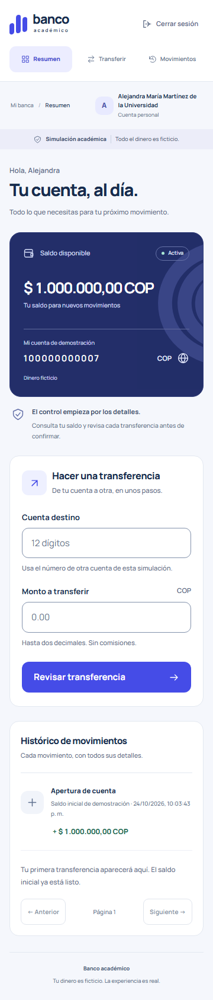
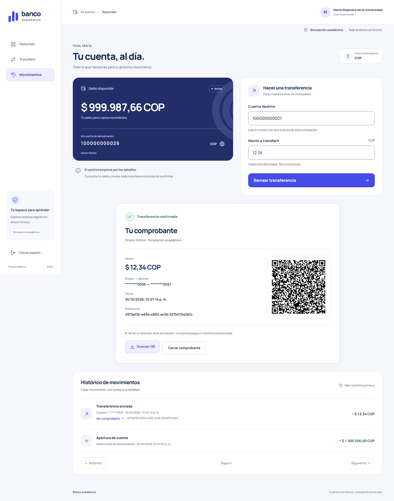
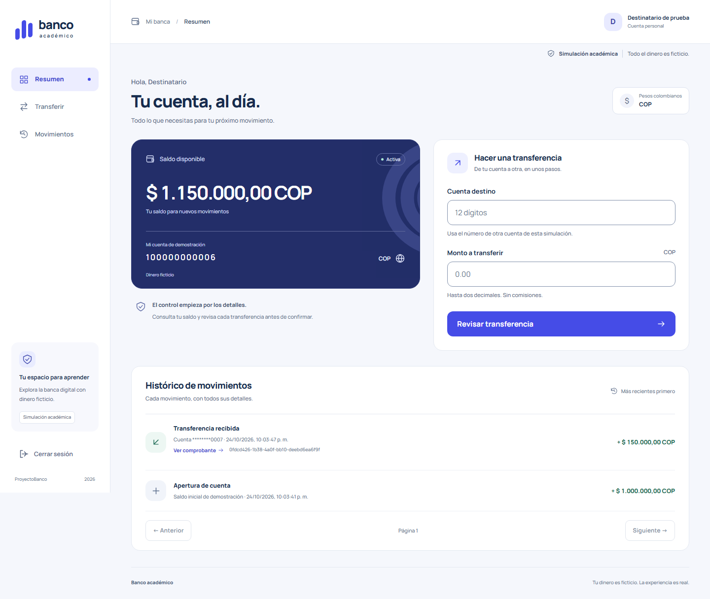

# Informe del ejercicio: transferencias bancarias

## 1. Portada

**Proyecto:** Banco académico — simulación de transferencias en COP.

**Institución:** Tecnológico de Antioquia. **Asignatura:** Diseño del Sistema. **Fecha de entrega:** 30 de octubre de 2026. **Autor, docente y grupo:** pendientes de completar por el estudiante; no se suministraron nombres.

Documento fuente para posterior maquetación Word/PDF. Todo el dinero es ficticio.

## 2. Introducción

El ejercicio solicita una aplicación completa para trasladar dinero entre cuentas, consultar el histórico y mostrar un QR con los datos básicos de cada transacción confirmada. Se entrega código local, informe y registro de prompts. Fuente: [SpringBoot AI.pdf](../SpringBoot%20AI.pdf), página 11.

## 3. Objetivo general

Construir y verificar una simulación full stack que transfiera valores exactos entre cuentas, conserve sus movimientos y permita consultar un comprobante QR sin duplicar la operación.

## 4. Objetivos específicos

- Registrar usuarios y crear una cuenta única con apertura ficticia.
- Autenticar y limitar consultas al titular.
- Garantizar atomicidad, concurrencia e idempotencia.
- Mostrar histórico propio y QR decodificable.
- Mantener código modular, Javadoc y evidencia reproducible.

## 5. Descripción del problema

Una transferencia requiere coherencia entre dos saldos y su registro. Una respuesta de red perdida puede inducir reenvíos; una operación concurrente puede sobrepasar fondos si no se coordina. La interfaz debe distinguir rechazo definitivo, resultado incierto y confirmación.

## 6. Requerimientos

Funcionales: registro, login/logout, cuenta automática, saldo inicial único de 1000000 COP, transferencias, histórico OPENING/SENT/RECEIVED y comprobante QR. Calidad: dinero decimal exacto, transacciones PostgreSQL, privacidad, CSRF, sesión de 30 minutos y recuperación de reintentos. Entregables académicos: informe, prompts y publicación posterior del código.

## 7. Tecnologías utilizadas

Java Temurin 25, Spring Boot 4.1.2, Spring Security, Spring Data JPA y PostgreSQL 18.6. React 19.3.1, TypeScript 6.0.3 y Vite 8.3.5 con Node 24. Maven Wrapper, Vitest, Playwright Chromium, jsQR y Javadoc. Versiones exactas en pom y package-lock; Prettier sólo formatea desarrollo.

## 8. Arquitectura

Monolito modular: auth registra identidades; account resuelve la cuenta propia; transfer aplica la operación monetaria completa; movement consulta el histórico. shared agrupa configuración, seguridad y errores. Frontend por funcionalidades y coordinación de sesión en useBanking. Una aplicación Spring Boot y una base PostgreSQL; ningún microservicio.

## 9. Estructura del proyecto

Consultar el árbol de [README](../README.md#estructura-por-funcionalidad). Cada módulo backend contiene controlador/DTO/servicio y, donde aplica, entidad/repositorio. React separa Access, AccountSummary, TransferForm, MovementHistory y ReceiptPanel; cliente HTTP y tipos son compartidos.

## 10. Modelo de datos

`app_user` almacena identidad, correo único y hash. `account` referencia propietario único, número único, balance NUMERIC(19,2) no negativo y fecha de apertura. `opening_movement` tiene una fila por cuenta y monto fijo de apertura. `bank_transfer` almacena UUID, origen/destino distintos, monto positivo, fecha y clave; UNIQUE(source_id,idempotency_key). Índices por cuenta/fecha permiten consultas de histórico. [SQL](../backend/src/main/resources/db/schema.sql).

## 11. Funcionamiento de registro/login

El registro valida nombre/correo/contraseña y normaliza correo. AuthService guarda hash PBKDF2, cuenta y apertura dentro de una transacción. Login autentica mediante Spring Security, rota ID de sesión y renueva CSRF. Registrar no inicia sesión automáticamente; el usuario accede explícitamente.

## 12. Funcionamiento de cuentas

Cada usuario posee una cuenta COP. Su número de doce dígitos se asigna por secuencia; huecos tras rollback son válidos. La apertura se crea una sola vez y no se repite al reiniciar, recargar o autenticar. El servidor determina la cuenta desde el principal.

## 13. Flujo de una transferencia

1. Escribir destino y monto.
2. Revisar los datos antes de confirmar.
3. Guardar una clave de operación estable por usuario en sessionStorage.
4. Enviar intención con CSRF e Idempotency-Key.
5. Backend valida y confirma la transacción.
6. Mostrar comprobante, actualizar saldo/histórico y generar QR.
7. Ante respuesta incierta comprobar o reenviar la misma clave; nunca reenviar automáticamente al iniciar sesión.

## 14. Manejo transaccional

TransferService ejecuta débito, crédito y registro bajo un único @Transactional. Bloquea ambas cuentas en ID ascendente y refresca entidades tras esperar. Comprueba replay antes de fondos, verifica saldo y límite del destino y hace flush antes del retorno. La respuesta HTTP llega después del commit del proxy. Errores revierten toda la operación; pruebas inducen una falla SQL para comprobarlo.

## 15. Histórico

MovementQueryRepository conserva una consulta UNION: apertura y transferencias propias. Cada transferencia aparece SENT para origen y RECEIVED para destino; no duplica el registro persistido. Página acotada y orden descendente estable por fecha/ID. La UI muestra fecha local, COP, contraparte enmascarada y referencia completa con acceso al comprobante.

## 16. Generación y contenido del QR

El generador recibe únicamente TransferReceiptResponse confirmado. JSON v1 contiene simulation=true, reference, occurredAt UTC, amount decimal, currency=COP, sourceAccountMasked y targetAccountMasked. Sólo revela cuatro dígitos de las cuentas. No incorpora credenciales, cookies o CSRF. Playwright decodifica la imagen PNG usando jsQR y compara contra el comprobante persistido. Regenerar o guardar imagen no invoca transferencias. El QR no está firmado ni autoriza pagos.

## 17. Endpoints

La tabla completa de métodos/rutas está en [README](../README.md#endpoints-principales). Mutaciones exigen X-CSRF-TOKEN; POST /transfers exige además Idempotency-Key UUID. El JSON conserva nombres en inglés y los montos viajan como cadenas. Los cambios de organización no alteran endpoints.

## 18. Validaciones

Cuenta destino de doce dígitos, distinta de la propia y existente; monto positivo de hasta dos decimales sin exponentes o redondeos silenciosos. Saldo suficiente y límite NUMERIC(19,2) del destino. Correos únicos, contraseña 12–128 caracteres en registro, paginación limitada. El backend repite validación sin confiar en UI.

## 19. Seguridad

Hash PBKDF2 adaptativo de Spring, sesión de servidor, HttpOnly, SameSite=Lax, CSRF, rotación de sesión al acceder y logout invalidante. Filtro de inactividad con límite exacto de 30 minutos. Autorización desde principal en cuenta, histórico y comprobantes; errores seguros. El perfil HTTP se limita a loopback. No representa certificación bancaria o auditoría completa de seguridad.

## 20. Pruebas realizadas

La referencia y la verificación posterior se documentan con comando/cwd/hora/exit en [verificación 002](../specs/002-revision-modular/verification.md). JUnit usa PostgreSQL real para apertura, rollback, montos, concurrencia, idempotencia y privacidad; también prueba el límite de inactividad. Vitest cubre utilidades, validación, cliente HTTP y estado pendiente. Playwright cubre HTTP/UI, QR real, A→B, reintentos y reinicio real. No se presenta compilación como prueba funcional.

## 21. Resultados

La corrida modular ejecutó39 pruebas:14 Java,14 Vitest y11 Playwright, todas aprobadas. Compilación, empaquetado, lint y Javadoc también aprobados en preflight. Consultar los resultados finales ejecutados en [verificación 002](../specs/002-revision-modular/verification.md); el informe no sustituye logs. En la referencia inicial se detectó PostgreSQL apagado (conexión rechazada), se inició el clúster aislado y se repitió. La refactorización conserva esquema y reglas, separa responsabilidades y mejora legibilidad. La URL GitHub permanece pendiente.

El rediseño 003 mantiene arquitectura y comportamiento, incorpora navegación por anclas, tipografía Manrope local y componentes visuales comunes. [Pruebas, capturas y límites actuales](../specs/003-rediseno-fintech/verification.md):40 pruebas en preflight, con comparación de42 archivos de backend/lógica sin cambios. Las cifras de39 pruebas anteriores corresponden a la revisión 002.

## 22. Capturas de pantalla

Las capturas finales revisadas se enlazan en [evidencia visual](../specs/002-revision-modular/verification.md). Deben acompañar acceso, cuenta móvil/escritorio, comprobante y validación. Las imágenes documentan apariencia; los recorridos y aserciones documentan interacción. No utilizar capturas anteriores como prueba del código nuevo.

## 23. Conclusiones

La separación por funcionalidad facilita localizar reglas sin distribuir una transacción entre servicios remotos. La exactitud monetaria, los locks y la identidad de reintento son esenciales incluso en una simulación. El QR comunica un resultado confirmado. Las pruebas independientes de decodificación y persistencia permiten evaluar el enunciado más allá del build.

## 24. Repositorio GitHub

**URL: pendiente de publicación autorizada.** No se inventa un enlace ni se ha ejecutado push. Antes de publicar se deben revisar ignores, estado Git y selección de archivos, configurar identidad y remoto con autorización del usuario. [Prompts reales](prompts.md) conserva el historial y la solicitud literal de esta revisión.

### Evolución: navegación modular004

Se conservó la identidad fintech003 y se separaron autenticación y banca mediante layouts/Outlet. BankingProvider mantiene useBanking por encima de las rutas protegidas. Resumen limita actividad a cinco filas; Transferencias conserva formulario y coordinador; Movimientos y Comprobantes consultan páginas reales; el detalle sólo usa GET. Perfil es de lectura. HashRouter evita cambios de servidor para recargas profundas. Búsqueda/filtros son locales a la página y se informa su alcance. No se agregó persistencia ni endpoint.

Regresión ejecutada:14 Java,21 Vitest y15 Playwright; build, lint, formato y Javadoc aprobados en preflight. Evidencia final ligada al código y capturas en [004](../specs/004-navegacion-modulos/verification.md). Backend y coordinador monetario preservados mediante42 hashes. Validación visual en Chromium Windows, no certificación universal de accesibilidad ni otros navegadores.
